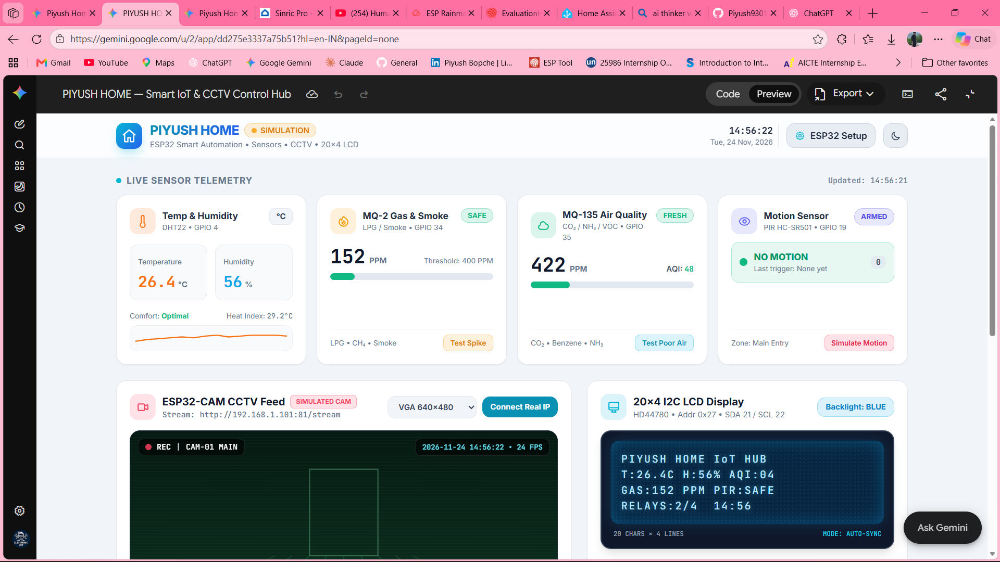

# PIYUSH HOME — Smart IoT & CCTV Control Hub

A responsive web dashboard for monitoring and controlling **PIYUSH HOME**, built for ESP32 smart automation, environmental and security sensors, an ESP32-CAM MJPEG CCTV stream, and a 20×4 I2C LCD display—complete with a built-in simulation mode for testing without hardware.

## Preview




> Save the image above as `assets/piyush-home-preview.png` (or update the path to your hosted screenshot URL) so it renders cleanly in your GitHub repository.

## Features

- **Live Sensor Telemetry**
  - **Temperature & Humidity (DHT22 — GPIO 4):** Real-time temperature with °C / °F toggle, humidity percentage, comfort status, heat index, and a live SVG sparkline.
  - **Combustible Gas & Smoke (MQ-2 — GPIO 34):** PPM readout, threshold monitoring, visual meter, and spike test trigger.
  - **Air Quality (MQ-135 — GPIO 35):** PPM and AQI score tracking for CO₂, NH₃, and VOCs, with a poor-air test trigger.
  - **Motion Detection (PIR HC-SR501 — GPIO 19):** Arm/disarm security toggle, motion event counter, last trigger timestamp, and motion simulation.
- **ESP32-CAM CCTV Feed**
  - Supports both a simulated live canvas feed and a real MJPEG stream URL (defaulting to `http://192.168.1.101:81/stream`).
  - Controls for resolution selection (`QVGA`, `VGA`, `HD`), flash toggle, Night IR mode, snapshot capture, and pause/resume.
- **20×4 I2C LCD Simulator & Controller**
  - Monospace 20×4 character display preview with custom line/message controls and backlight/theme styling.
- **Alerts, Controls & Hardware Setup**
  - Global hazard alert banner for gas/motion alarms, dark/light theme toggle, and a modal to configure ESP32 endpoints and hardware settings.

## Tech Stack

- **HTML5, CSS3 & Vanilla JavaScript** (single-file `piyush-home-iot-hub.html`)
- **Tailwind CSS** (via CDN)
- **Google Fonts:** `Inter` and `JetBrains Mono`

## Getting Started

1. **Clone or download the repository:**
   ```bash
   git clone [https://github.com/](https://github.com/)<your-username>/piyush-home-iot-hub.git
   cd piyush-home-iot-hub
